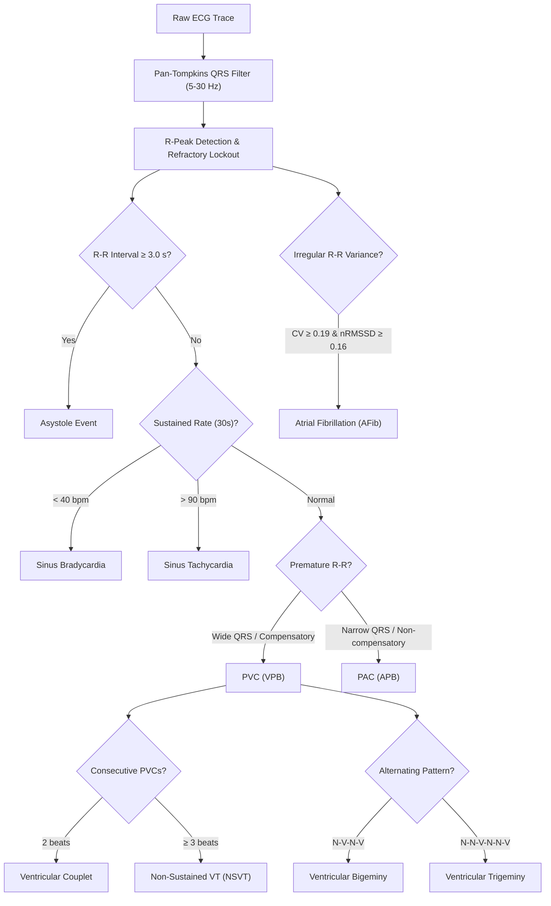

# 5. Automated Cardiac & Arrhythmia Analysis

Sleep-disordered breathing and sleep fragmentation have profound impacts on cardiac autonomic regulation. CCS Sleep Studio includes a native clinical ECG analysis engine adhering strictly to the **American Academy of Sleep Medicine (AASM) Scoring Manual (Section VIII: Cardiac Rules)**.

---

## 🫀 The AASM Cardiac Rules

Under AASM polysomnography scoring guidelines, cardiac events must be identified and recorded during overnight recordings:



---

## 🚀 Running Cardiac & Arrhythmia Analysis

1. From the top menu, select **Utilities ➔ Automated AASM Cardiac Event Analysis (ECG)…** (or trigger it directly from Step 5 of the Workflow bar).
2. The setup dialog opens:

```
+-------------------------------------------------------------------------------+
| Automated AASM Cardiac & Arrhythmia Analysis (ECG)                    [ X ]   |
+-------------------------------------------------------------------------------+
|  ECG Signal Channel: [ ECG                                          v ]       |
|                                                                               |
|  Asystole Pause:     [ 3.0 ] sec                                              |
|  Bradycardia Limit:  [ 40  ] bpm (sustained ≥ 30s)                            |
|  Tachycardia Limit:  [ 90  ] bpm (sustained ≥ 30s)                            |
|                                                                               |
|  [✓] Include Arrhythmia Analysis (PVC, PAC, Couplets, Bigeminy/Trigeminy,     |
|      VT/SVT, Atrial Fibrillation)                                             |
|                                                                               |
|                     [ Cancel ]            [ Run Cardiac Analysis ]            |
+-------------------------------------------------------------------------------+
```

3. Confirm your ECG channel (CCS Sleep Studio auto-detects `ECG`, `EKG`, or `Heart`).
4. Click **Run Cardiac Analysis**.
5. Within 1–2 seconds, the algorithm processes the overnight signal and presents a comprehensive clinical summary:

```
+-------------------------------------------------------------------------------+
| Cardiac Analysis Summary:                                                     |
| ----------------------------------------------------------------------------- |
| Total Detected Heartbeats:         32,450 beats                               |
| Mean Heart Rate (Sleep):           64.2 bpm (Min: 44 bpm, Max: 108 bpm)       |
| Longest Cardiac Pause:             2.45 s                                     |
| Asystole Events (≥ 3.0s):          0                                          |
| Bradycardia Episodes (< 40 bpm):   0                                          |
| Tachycardia Episodes (> 90 bpm):   4                                          |
| Premature Ventricular (PVC / VPB): 84 (Couplets: 3, Bigeminy: 1)              |
| Premature Atrial (PAC / APB):      12                                         |
| Arrhythmia Episodes:               4                                          |
|                                                                               |
| Stage Heart Rates:                                                            |
| [ WAKE: 74.5 bpm ] [ N1: 68.2 bpm ] [ N2: 63.4 bpm ] [ N3: 58.1 bpm ] [ REM: 69.8 bpm ] |
|                                                                               |
|                     [ Cancel ]            [ Add 92 Events to Recording ]      |
+-------------------------------------------------------------------------------+
```

6. Click **Add Events to Recording**. All detected asystoles, bradycardias, tachycardias, PVCs, PACs, couplets, and arrhythmias are tagged onto the timeline.

---

## 📊 Arrhythmia Scoring Criteria Details

### 1. Asystole
- **Criteria**: Cardiac pause $\ge 3.0$ seconds between consecutive R-waves in adults.
- **Label**: `Asystole (3.4s)`

### 2. Sinus Bradycardia
- **Criteria**: Sustained heart rate $< 40\text{ bpm}$ for $\ge 30$ seconds during sleep.
- **Label**: `Bradycardia (<40 bpm)`

### 3. Sinus Tachycardia
- **Criteria**: Sustained heart rate $> 90\text{ bpm}$ for $\ge 30$ seconds during sleep.
- **Label**: `Tachycardia (>90 bpm)`

### 4. Premature Ventricular Contractions (PVC / VPB)
- **Criteria**: Ectopic ventricular beat characterized by prematurity ($RR < 0.82 \times RR_{\text{median}}$), wide QRS complex ($\ge 110\text{ ms}$), and full compensatory pause ($(RR_{\text{prev}} + RR_{\text{next}}) \ge 1.85 \times RR_{\text{median}}$).
- **Patterns**:
  - **Isolated PVC**: Single ectopic beat.
  - **Ventricular Couplet**: 2 consecutive PVCs.
  - **Ventricular Tachycardia (NSVT)**: Run of $\ge 3$ consecutive PVCs at rate $> 100\text{ bpm}$.
  - **Ventricular Bigeminy**: Repeated alternating normal and PVC beats ($N\text{-}V\text{-}N\text{-}V$) for $\ge 3$ cycles.
  - **Ventricular Trigeminy**: Normal-Normal-PVC sequence ($N\text{-}N\text{-}V\text{-}N\text{-}N\text{-}V$) for $\ge 2$ cycles.

### 5. Premature Atrial Contractions (PAC / APB)
- **Criteria**: Premature narrow QRS complex without full compensatory pause.
- **Patterns**:
  - **Isolated PAC**: Single premature supraventricular beat.
  - **Supraventricular Tachycardia (SVT)**: Run of $\ge 3$ consecutive PACs at rate $> 100\text{ bpm}$.

### 6. Atrial Fibrillation (AFib)
- **Criteria**: Evaluated across sliding 30-second epochs. Detected by an irregularly irregular ventricular rhythm with high coefficient of variation ($CV_{RR} \ge 0.19$) and elevated root mean square of successive differences ($nRMSSD \ge 0.16$) sustained for $\ge 30$ seconds.
- **Label**: `Atrial Fibrillation (AFib)`
