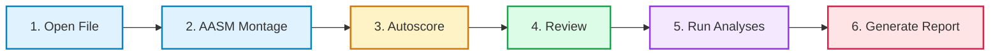

# Welcome to the CCS Sleep Studio Wiki

  

Welcome to the official documentation and visual tutorial for **CCS Sleep Studio**, developed by the **Centre for Consciousness Studies (CCS)** at the **National Institute of Mental Health and Neurosciences (NIMHANS)**, Bengaluru, India.

CCS Sleep Studio is a high-performance, standalone, zero-Python desktop application designed for clinicians, research fellows, sleep technicians, and neuroscientists. Whether you are scoring your first polysomnogram (PSG) or conducting large-cohort quantitative sleep research, this guide will walk you through every feature step by step.

---

## 📚 Table of Contents

| Section | Description | Target Audience |
| :--- | :--- | :--- |
| [**1. Installation & Quick Setup**](01-Getting-Started-and-Installation.md) | Download, install, and run on macOS, Windows, and Linux | Everyone |
| [**2. The 6-Step Clinical Workflow**](02-The-6-Step-Clinical-Workflow.md) | Visual guide to the guided workflow bar from file loading to report | Technicians & Clinicians |
| [**3. Waveform Viewer & Inspection Tools**](03-Waveform-Viewer-and-Inspection-Tools.md) | Time grid, measurement caliper, channel solo, font scaling, hover tips | Active Scorer |
| [**4. Sleep Scoring & Clinical Annotations**](04-Manual-Sleep-Scoring-and-Annotations.md) | Staging (W, N1-N3, REM), event tagging, typable markers, shortcuts | Clinicians & Fellows |
| [**5. Automated Cardiac & Arrhythmia Analysis**](05-Automated-Cardiac-and-Arrhythmia-Analysis.md) | ECG analysis: Asystole, Brady/Tachycardia, PVCs, PACs, Couplets, AFib | Physicians & Researchers |
| [**6. Quantitative Analysis & Publication Reports**](06-Advanced-Analysis-and-Publication-Reports.md) | Spectral powers, 2D scalp topoplots, spindles, PAC, OSA, PLMS | Research Investigators |
| [**7. Troubleshooting & FAQ**](07-Troubleshooting-and-FAQ.md) | Common questions, file formats, and tips | Everyone |

---

## ⚡ The Clinical Philosophy: Guided 6-Step Pipeline

CCS Sleep Studio simplifies complex sleep medicine workflows into a top-level sequence that prevents missed steps:

1. **Open File (`Ctrl+O` / `Cmd+O`)**: Load European Data Format (`.edf`, `.edf+`), BrainVision (`.vhdr`), Nihon Kohden (`.EEG`), EMBLA (`.ebm`), or Orbit (`.orb`).
2. **AASM Montage (`Ctrl+M`)**: Automatically reference EEG channels ($F_4\text{-}M_1$, $C_4\text{-}M_1$, $O_2\text{-}M_1$), EOG ($E_1\text{-}M_2$, $E_2\text{-}M_2$), and Chin EMG.
3. **Autoscore (`Ctrl+A`)**: Run state-of-the-art AI sleep staging models in under 5 seconds.
4. **Review (`Spacebar` to navigate)**: Manually inspect and refine epochs with clinical event markers.
5. **Run Analyses (`Ctrl+R`)**: 1-click comprehensive analysis of sleep microstructure (spindles, slow waves, PAC), cardio-respiratory events (OSA, AHI, cardiac arrhythmias), and limb movements.
6. **Generate Report (`Ctrl+P`)**: Export high-resolution 5-page publication-grade PDF summaries with hypnograms, 2D scalp topoplots, and multi-line spectral power trends.

---

## ⌨️ Essential Keyboard Shortcuts Quick Reference

| Action | macOS Shortcut | Windows / Linux Shortcut |
| :--- | :--- | :--- |
| **Open File** | <kbd>Cmd</kbd> + <kbd>O</kbd> | <kbd>Ctrl</kbd> + <kbd>O</kbd> |
| **Next / Previous Epoch** | <kbd>Spacebar</kbd> / <kbd>Shift</kbd> + <kbd>Space</kbd> | <kbd>Spacebar</kbd> / <kbd>Shift</kbd> + <kbd>Space</kbd> |
| **Score Wake (W)** | <kbd>0</kbd> or <kbd>W</kbd> | <kbd>0</kbd> or <kbd>W</kbd> |
| **Score N1 / N2 / N3** | <kbd>1</kbd> / <kbd>2</kbd> / <kbd>3</kbd> | <kbd>1</kbd> / <kbd>2</kbd> / <kbd>3</kbd> |
| **Score REM (R)** | <kbd>5</kbd> or <kbd>R</kbd> | <kbd>5</kbd> or <kbd>R</kbd> |
| **Toggle Time Grid (1s / 5s)** | <kbd>G</kbd> | <kbd>G</kbd> |
| **Custom Typable Marker** | <kbd>T</kbd> or <kbd>Shift</kbd> + <kbd>M</kbd> | <kbd>T</kbd> or <kbd>Shift</kbd> + <kbd>M</kbd> |
| **Zoom Selected Signal** | <kbd>Z</kbd> | <kbd>Z</kbd> |
| **Solo / Unsolo Channel** | Double-click channel label | Double-click channel label |
| **Restore All Channels** | <kbd>Esc</kbd> | <kbd>Esc</kbd> |
| **Scale Font Up / Down / Reset** | <kbd>Cmd</kbd>+<kbd>Alt</kbd>+<kbd>=</kbd> / <kbd>-</kbd> / <kbd>0</kbd> | <kbd>Ctrl</kbd>+<kbd>Alt</kbd>+<kbd>=</kbd> / <kbd>-</kbd> / <kbd>0</kbd> |
| **Save Annotations** | <kbd>Cmd</kbd> + <kbd>S</kbd> | <kbd>Ctrl</kbd> + <kbd>S</kbd> |
| **Export PDF Report** | <kbd>Cmd</kbd> + <kbd>P</kbd> | <kbd>Ctrl</kbd> + <kbd>P</kbd> |
